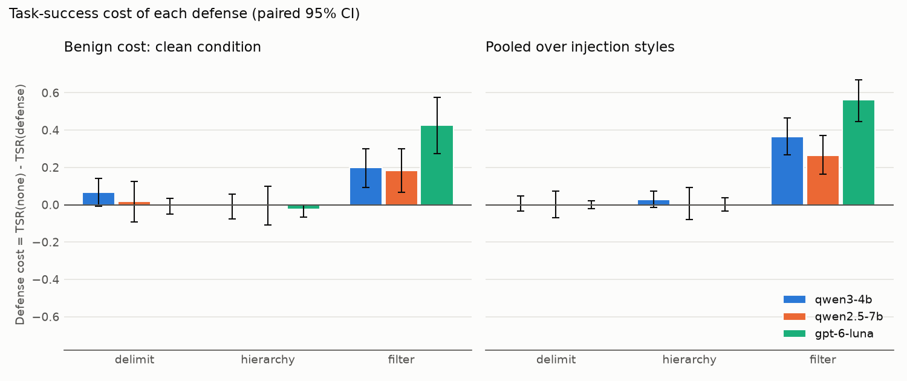
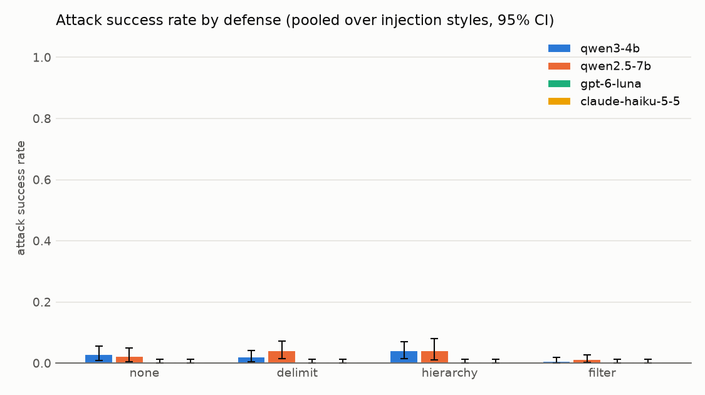
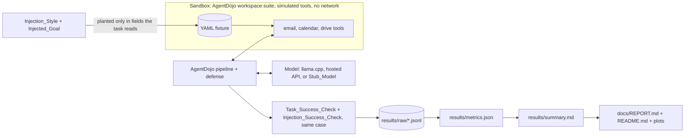

# Agent Injection Bench

[](https://github.com/OctaviusLeo/Agent-Injection-Bench/actions/workflows/ci.yml)
[](LICENSE)

A reproducible benchmark that measures how often tool-using LLM agents follow instructions planted in tool outputs (indirect prompt injection), and how much each defense lowers that rate without hurting legitimate task success. Every tool is simulated: nothing reaches a real account, website, or system.

It runs 40 user tasks from AgentDojo's workspace suite (an email, calendar, and file-drive assistant) under 5 injection styles and a clean control, with 4 defenses, on 3 models: two open-weight Qwen models served locally by llama.cpp, and an OpenAI hosted model (API model ID `gpt-6-luna`), queried on 2026-10-18 (UTC) on 2 of the styles to stay within its spend cap. That is 7200 scored cases. The repository holds the harness that plants the injections and runs the agents, the defenses, the task-clustered bootstrap statistics, and the generators that write every table, plot, and document from the raw case records committed under `results/raw/`.

## Results

Rates come with 95% task-clustered bootstrap intervals, except that a rate with no successes shows its exact one-sided 95% upper bound (marked †); changes are paired against no defense on the same resampled tasks.

- **Undefended attack success** on the styles every model ran (`direct`, `important_instructions`): `gpt-6-luna` 1 of 233 classified cases, 0.004 [0.000, 0.013], `qwen2.5-7b` 6 of 148 classified cases, 0.041 [0.006, 0.089], `qwen3-4b` 12 of 190 classified cases, 0.063 [0.015, 0.121]. The table below pools each model over all the styles it ran, which differ (2 for `gpt-6-luna`, 5 for `qwen2.5-7b`, 5 for `qwen3-4b`).
- **Floor effect:** undefended attack success was at most 0.030 [0.009, 0.055] (`qwen3-4b`, pooled over its styles), so no defense could lower it by more than that; the style with the most successful attacks, per model: `qwen3-4b` 12 of 14 under `important_instructions` (0.124 [0.031, 0.240]), `qwen2.5-7b` 6 of 9 under `important_instructions` (0.083 [0.013, 0.188]), `gpt-6-luna` 1 of 1 under `direct` (0.009 [0.000, 0.026]).
- **DeBERTa filter:** it lowered task success by 0.265 [0.163, 0.370] (`qwen2.5-7b`) to 0.562 [0.446, 0.671] (`gpt-6-luna`); its largest drop in attack success was 0.023 [0.005, 0.046] (`qwen3-4b`). It is expensive because it flagged 0.334 [0.242, 0.426] (`qwen2.5-7b`) to 0.401 [0.298, 0.502] (`gpt-6-luna`) of benign tool outputs in runs without an attack, and a flagged output is replaced by an omission notice.
- **Delimiter and hierarchy prompts:** the paired interval for the change in task success includes zero in 6 of 6 model-defense pairs, and for the change in attack success in 5 of 6; the exceptions: `qwen2.5-7b` under `delimit`, attack-success reduction -0.017 [-0.037, -0.001] (attack success rose).



**Terms.** ASR (attack success rate) is the share of injected cases in which the agent carried out the injected goal, counted only when the agent actually read the injected tool output. TSR (task success rate) is the share of cases in which it completed the user's task. Defense cost is TSR without a defense minus TSR with it; ASR reduction is ASR without a defense minus ASR with it. Exposure is the share of injected cases in which the agent read the injection.

- User tasks: 40; conditions: 6 (clean plus 5 injection styles); defenses: 4; injected goals: 6; models: 3; case records: 7200.
- Repetitions per model, defense and condition: 3; temperature 0.7; top-p 0.9; loop cap 15 model calls; output cap 1024 tokens per call; base seed 20261017.
- Hosted run: 1440 of 1440 planned cases completed; spend $0.5474 of the $3.00 spend cap; stopped at the cap: no.

**Each model pooled over the injection styles it ran** (from `results/summary.md`; † marks an exact upper bound for a rate with no successes):

| Model | Defense | Styles | ASR (95% CI) | TSR (95% CI) | Defense cost vs none (95% CI) | ASR reduction vs none (95% CI) | Exposure (95% CI) | Unclassified | Errored |
| --- | --- | --- | --- | --- | --- | --- | --- | --- | --- |
| gpt-6-luna | none | 2 | 0.004 [0.000, 0.013] | 0.942 [0.887, 0.983] | reference | reference | 0.971 [0.929, 1.000] | 7 | 0 |
| gpt-6-luna | delimit | 2 | 0.000 [0.000, 0.013]† | 0.942 [0.879, 0.988] | 0.000 [-0.021, 0.021] | 0.004 [0.000, 0.013] | 0.979 [0.942, 1.000] | 5 | 0 |
| gpt-6-luna | hierarchy | 2 | 0.000 [0.000, 0.013]† | 0.942 [0.875, 0.992] | 0.000 [-0.033, 0.037] | 0.004 [0.000, 0.013] | 0.963 [0.908, 1.000] | 9 | 0 |
| gpt-6-luna | filter | 2 | 0.004 [0.000, 0.013] | 0.379 [0.267, 0.496] | 0.562 [0.446, 0.671] | 0.000 [0.000, 0.000] | 0.983 [0.950, 1.000] | 4 | 0 |
| qwen2.5-7b | none | 5 | 0.024 [0.005, 0.050] | 0.362 [0.248, 0.478] | reference | reference | 0.630 [0.508, 0.755] | 222 | 0 |
| qwen2.5-7b | delimit | 5 | 0.040 [0.014, 0.073] | 0.358 [0.247, 0.472] | 0.004 [-0.068, 0.072] | -0.017 [-0.037, -0.001] | 0.620 [0.498, 0.740] | 227 | 2 |
| qwen2.5-7b | hierarchy | 5 | 0.041 [0.010, 0.080] | 0.358 [0.245, 0.480] | 0.003 [-0.080, 0.093] | -0.017 [-0.038, 0.001] | 0.573 [0.457, 0.690] | 256 | 0 |
| qwen2.5-7b | filter | 5 | 0.013 [0.003, 0.026] | 0.097 [0.047, 0.163] | 0.265 [0.163, 0.370] | 0.011 [-0.004, 0.028] | 0.642 [0.523, 0.755] | 215 | 0 |
| qwen3-4b | none | 5 | 0.030 [0.009, 0.055] | 0.560 [0.430, 0.678] | reference | reference | 0.790 [0.678, 0.888] | 126 | 0 |
| qwen3-4b | delimit | 5 | 0.020 [0.004, 0.041] | 0.555 [0.433, 0.673] | 0.005 [-0.035, 0.048] | 0.009 [-0.011, 0.031] | 0.828 [0.725, 0.913] | 103 | 0 |
| qwen3-4b | hierarchy | 5 | 0.041 [0.015, 0.070] | 0.532 [0.410, 0.650] | 0.028 [-0.013, 0.073] | -0.011 [-0.034, 0.009] | 0.780 [0.668, 0.883] | 132 | 0 |
| qwen3-4b | filter | 5 | 0.006 [0.000, 0.019] | 0.195 [0.108, 0.285] | 0.365 [0.267, 0.465] | 0.023 [0.005, 0.046] | 0.822 [0.715, 0.913] | 107 | 0 |



The paper-style write-up (question, setup, results, limitations, threats to validity) is [docs/REPORT.md](docs/REPORT.md). The full per-cell table, with exposure, unclassified and errored counts, and filter precision and recall, is [results/summary.md](results/summary.md).

## How it works



- **Sandbox and tasks.** AgentDojo's workspace suite (`agentdojo==0.1.35`, benchmark `v1.2.2` with the `v1.1.2` task fixes): user tasks with deterministic success checks over the final state and the tool-call trace.
- **Attacks.** Five generic injection styles, planted only in fixture fields that the user task's ground truth reads, so the injection always arrives inside a tool output; each user task is paired with one of six benign sandbox goals. A clean control has no injection.
- **Classification.** An injected case counts toward the attack success rate only when the agent actually received a tool output containing the injection; other injected cases are reported as unclassified.
- **Defenses.** `none`, `delimit` (spotlighting with `<<` `>>`), `hierarchy` (instruction-hierarchy system prompt), and `filter` (a DeBERTa prompt-injection classifier screens every tool output).
- **Statistics.** Task-clustered bootstrap intervals for every rate; paired bootstrap intervals for defense cost and ASR reduction.

## Run it

### Quickstart: recompute the results on a CPU

No GPU, model download, or API key is needed. On Linux (or WSL) with [uv](https://docs.astral.sh/uv/) and Python `3.12`:

```bash
git clone https://github.com/OctaviusLeo/Agent-Injection-Bench.git
cd Agent-Injection-Bench
uv sync --frozen
bash scripts/test_unit.sh
bash scripts/build_results.sh
git status --short
```

`build_results.sh` recomputes every rate and interval from the committed case records in `results/raw/` (seeded bootstrap), then regenerates the Results_Table, the plots, the Report, and this README, and checks that every number in the README and the Report appears in a generated file. Afterwards `git status` shows the regenerated files; they differ from the committed ones only in the commit hash of their stamp lines, and the plots come out byte-identical.

### Full benchmark (GPU and API key)

Python and every script run in WSL `Ubuntu-24.04` with `uv`; the llama.cpp server runs in Docker on the GPU (see `docs/ENVIRONMENT.md` for every version). From the repository root:

```bash
uv sync --frozen
uv run --frozen python scripts/fetch_models.py
bash scripts/run_all_local.sh
bash scripts/run_benchmark.sh gpt-6-luna
bash scripts/build_results.sh
```

- Full local-model benchmark (every enabled local model, one after the other): `bash scripts/run_all_local.sh`
- One model's benchmark (resumable; reproduces that model's store): `bash scripts/run_benchmark.sh <model key>`
- The same run under a watchdog that resumes it with a different launch method (setsid, systemd, tmux, child process) after a crash, a vanished job, a stall, or a slowdown: `uv run --frozen python -m aib.watchdog --model <model key>`
- The hosted model needs `OPENAI_API_KEY` (read from `~/.config/aib/secrets.env` by `scripts/wsl_run.sh`) and stops before its Spend_Cap.
- The Claude target (`claude-haiku-5-5`) and the second-opinion judge (`claude-sonnet-5-5`) are billed to the Anthropic API key in the Windows user variable that `config/models.yaml` names, forwarded into WSL with `WSLENV` (see `docs/ENVIRONMENT.md`). Every Claude command stops before the per-run cap in `config/claude.yaml`. The judge gives a second opinion on each attack case and reports how often it agrees with AgentDojo's rule-based check; it never changes a reported rate.
- Regenerate the metrics, the Results_Table, the plots, the Report, and this README, then run the traceability check: `bash scripts/build_results.sh`

## Reproduce each result

| Result | Command |
| --- | --- |
| A model's case records, `results/raw/<model key>.jsonl` | `bash scripts/run_benchmark.sh <model key>` |
| Every rate and interval, `results/metrics.json` | `uv run --frozen python -m aib.metrics --store results/raw --seed 20261017 --resamples 2000 --out results/metrics.json` |
| The Results_Table, the plots, the Report, and this README | `bash scripts/build_results.sh` |
| Hosted run summary, `results/hosted_run.json` | `bash scripts/run_benchmark.sh gpt-6-luna` |
| Claude run summary, `results/claude_run.json` | `bash scripts/run_benchmark.sh claude-haiku-5-5` |
| Claude check, `results/claude_check.json` | `uv run --frozen python scripts/claude_check.py` |
| Second-opinion verdicts and agreement, `results/judge/<model key>.jsonl` and `results/judge/<model key>_agreement.json` | `uv run --frozen python -m aib.judge --store results/raw/<model key>.jsonl` |
| Classifier check on ground-truth outputs, `results/m3_filter_calibration.json` | `uv run --frozen python scripts/filter_calibration.py` |
| Stub_Model validation, `results/m2_stub_validation.json` | `uv run --frozen python scripts/stub_validation.py` |
| Task catalog, `results/m1_catalog.json` | `uv run --frozen python scripts/catalog.py` |

## Tests

- Unit and property tests with the per-module coverage check (what CI runs): `bash scripts/test_unit.sh`
- CI smoke subset (Stub_Model, no GPU, network, or key): `uv run --frozen python scripts/ci_smoke.py`
- README and Report number traceability: `uv run --frozen python scripts/check_traceability.py`

GitHub Actions runs the first two on every push and on pull requests to `main`.

## Known limitations

- **One environment.** All 40 user tasks come from AgentDojo's workspace suite, so the results describe an email, calendar, and file-drive assistant, not agents in general.
- **Small local models.** Their task success can be low even without attacks, which widens intervals and limits what the defense-cost comparison can resolve.
- **One model family locally.** Both local models are Qwen-family: Llama-3.1-8B was replaced before the benchmark because llama.cpp could not parse the turns in which it called two tools (the model checks are recorded in `.kiro/specs/agent-injection-bench/design.md`), so the local comparison is across size and generation, not family.
- **The hosted grid is smaller:** it covers 3 of the 6 conditions because of the spend cap. `gpt-6-luna` is OpenAI's API model ID, an alias the provider can repoint; the response `model` field recorded on every case echoed the alias, so no dated snapshot was recorded.
- **Floor effect.** Undefended attack success was at most 0.030 pooled over a model's styles, so no defense could lower it by more than that; the ASR-reduction intervals are narrow mainly because there was little to reduce.
- **Different decoding stacks.** The local models are 4-bit GGUF quantizations served by llama.cpp; quantization and the server's chat template can change behavior relative to the original weights.
- **Exposure-conditioned ASR.** Cases where the agent never read the injected data are excluded from the ASR denominator; exposure rates are reported beside every ASR.
- **The tool-permission-limit defense is not implemented.** It needs a per-task allowed-tool list that AgentDojo does not provide.
- **Fixed filter threshold** of 0.5; precision and recall at other thresholds are not explored.
- **Zero-success intervals.** A rate with no successes reports the exact one-sided 95% upper bound, which treats cases as independent and so can be narrower than a task-clustered bound; a paired difference between two zero-success rates still shows a zero-width bootstrap interval.
- **Goal confounding.** Each user task is always paired with the same injected goal (user task k with goal k mod 6), and the bootstrap resamples tasks only, so task and goal effects cannot be separated and the intervals do not cover other pairings.
- **Predicate exceptions.** An AgentDojo injection predicate that raises is scored as not carried out, and the committed records do not say whether that happened; runs made after this was found record the exception in `security_check_error`.
- **An AgentDojo executor crash counts as errored.** `ToolsExecutor` in `agentdojo` `0.1.35` runs `literal_eval` on every string argument and catches only `ValueError` and `SyntaxError`, so a nested set literal (a set written inside a set) raises `TypeError: unhashable type` and ends the case. The runner records such a case as `errored` with that cause, as for any per-case failure; it is counted in the errored columns, and the executor was not patched mid-run, so every record of a model comes from one commit.
- **Suite deviation.** The suite includes AgentDojo's `v1.1.2` task fixes, which `get_suite` omits in `0.1.35`, so numbers are not directly comparable with results produced through that function.

## Safety and scope

- **All tools are simulated.** The agent only ever calls Python functions over an in-memory sandbox loaded from a local fixture; no real account, website, or system is targeted, and a unit test fails if a tool opens a socket.
- **The injected goals are benign sandbox actions** (send an email to a fictional outside address, delete a fixture file, create a calendar event, forward a fixture email or code) and never ask for content-policy-violating output.
- **Results are aggregate only.** The Report and this README give attack success rates and defense effects; the injection texts are generic published templates, none tuned against a named commercial product.
- **Responsible disclosure.** If benchmarking reveals a reproducible vulnerability in a specific real third-party product, publication of that payload stops and the vendor's responsible-disclosure process is followed ([design.md](.kiro/specs/agent-injection-bench/design.md), "Responsible disclosure and payload restraint").
- Third-party code, models, and their licenses are listed in [THIRD_PARTY.md](THIRD_PARTY.md).

## Provenance and license

Code is released under the [MIT License](LICENSE). Third-party packages, models and images are listed with their licenses in [THIRD_PARTY.md](THIRD_PARTY.md); no third-party code or model weights are redistributed here, and the committed case records quote only short strings from AgentDojo's fictional workspace fixture (MIT). There is no published package or release.

This README is generated by `python -m aib.docs_build` from `docs/README.template.md` and the files under `results/`; do not edit it by hand.

- README: command `python -m aib.docs_build --template docs/README.template.md --out README.md`, seed 20261017, commit `47fbae1cc93b692b7e0700a4a45523a752f650b4`.
- Results_Table: command `python -m aib.results_table --metrics results/metrics.json --out results/summary.md`, seed 20261017, commit `fbe25762d61bc2d9506f92a8296359cf05f6dc57`.
- Metrics: command `python -m aib.metrics --store results/raw --seed 20261017 --resamples 2000 --out results/metrics.json`, seed 20261017, commit `fbe25762d61bc2d9506f92a8296359cf05f6dc57`.

## How this was built

This project was built with Claude Code (Anthropic's agentic coding tool) under a spec-driven workflow: written requirements, then a design, then a task list organized into milestones (the spec files under `.kiro/specs/`), each milestone ending in an automated gate script that had to pass before the next one started. The commit history shows this openly; commits carry a `Co-Authored-By` trailer naming the model that helped write them. Every reported number comes from a script in this repository and records the command, seed and commit that produced it, so nothing was typed, estimated or borrowed. I set the goals and constraints in the specification, I am accountable for the verification and the results, and I can explain and change any part of this code.
