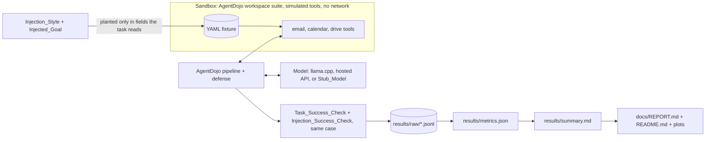

# Agent Injection Bench

A reproducible benchmark that measures how often tool-using LLM agents follow instructions planted in tool outputs (indirect prompt injection), and how much each defense lowers that rate without hurting legitimate task success. Every tool is simulated: nothing reaches a real account, website, or system.

Code is released under the [MIT License](LICENSE). Third-party packages, models and images are listed with their licenses in [THIRD_PARTY.md](THIRD_PARTY.md); none are redistributed here. There is no published package or release.

This README is generated by `python -m aib.docs_build` from `docs/README.template.md` and the files under `results/`; do not edit it by hand.

- README: command `{{readme_command}}`, seed {{readme_seed}}, commit `{{readme_commit}}`.
- Results_Table: command `{{summary_command}}`, seed {{summary_seed}}, commit `{{summary_commit}}`.
- Metrics: command `{{metrics_command}}`, seed {{metrics_seed}}, commit `{{metrics_commit}}`.

## Results

{{run_facts}}

**Pooled over the Injection_Styles** (from `results/summary.md`; every rate has its 95% interval; Defense_Cost and ASR reduction are relative to `none` with paired intervals):

{{pooled_table}}


The paper-style write-up (question, setup, results, limitations, threats to validity) is [docs/REPORT.md](docs/REPORT.md). The full per-Cell table, with exposure, unclassified and errored counts, and filter precision and recall, is [results/summary.md](results/summary.md).

## How it works



- **Sandbox and tasks.** AgentDojo's workspace suite (`agentdojo==0.1.35`, benchmark `v1.2.2` with the `v1.1.2` task fixes): user tasks with deterministic success checks over the final state and the tool-call trace.
- **Attacks.** Five generic injection styles, planted only in fixture fields that the user task's ground truth reads, so the injection always arrives inside a tool output; each user task is paired with one of six benign sandbox goals. A clean control has no injection.
- **Classification.** An injected case counts toward the attack success rate only when the agent actually received a tool output containing the injection; other injected cases are reported as unclassified.
- **Defenses.** `none`, `delimit` (spotlighting with `<<` `>>`), `hierarchy` (instruction-hierarchy system prompt), and `filter` (a DeBERTa prompt-injection classifier screens every tool output).
- **Statistics.** Task-clustered bootstrap intervals for every rate; paired bootstrap intervals for Defense_Cost and ASR reduction.

## Run it

Python and every script run in WSL `Ubuntu-24.04` with `uv`; the llama.cpp server runs in Docker on the GPU (see `docs/ENVIRONMENT.md` for every version). From the repository root:

```bash
uv sync --frozen
uv run --frozen python scripts/fetch_models.py
bash scripts/run_all_local.sh
bash scripts/run_benchmark.sh gpt-6-luna
bash scripts/build_results.sh
```

- Full local-model benchmark (every enabled local model, one after the other): `bash scripts/run_all_local.sh`
- One model's benchmark (resumable; reproduces that model's store): `bash scripts/run_benchmark.sh <model key>`
- The same run under a watchdog that resumes it with a different launch method (setsid, systemd, tmux, child process) after a crash, a vanished job, a stall, or a slowdown: `uv run --frozen python -m aib.watchdog --model <model key>`
- The hosted model needs `OPENAI_API_KEY` (read from `~/.config/aib/secrets.env` by `scripts/wsl_run.sh`) and stops before its Spend_Cap.
- Regenerate the metrics, the Results_Table, the plots, the Report, and this README, then run the traceability check: `bash scripts/build_results.sh`

## Reproduce each result

| Result | Command |
| --- | --- |
| A model's case records, `results/raw/<model key>.jsonl` | `bash scripts/run_benchmark.sh <model key>` |
| Every rate and interval, `results/metrics.json` | `uv run --frozen python -m aib.metrics --store results/raw --seed 20261017 --resamples 2000 --out results/metrics.json` |
| The Results_Table, the plots, the Report, and this README | `bash scripts/build_results.sh` |
| Hosted run summary, `results/hosted_run.json` | `bash scripts/run_benchmark.sh gpt-6-luna` |
| Classifier check on ground-truth outputs, `results/m3_filter_calibration.json` | `uv run --frozen python scripts/filter_calibration.py` |
| Stub_Model validation, `results/m2_stub_validation.json` | `uv run --frozen python scripts/stub_validation.py` |
| Task catalog, `results/m1_catalog.json` | `uv run --frozen python scripts/catalog.py` |

## Tests

- Unit and property tests with the per-module coverage check (what CI runs): `bash scripts/test_unit.sh`
- CI smoke subset (Stub_Model, no GPU, network, or key): `uv run --frozen python scripts/ci_smoke.py`
- README and Report number traceability: `uv run --frozen python scripts/check_traceability.py`

GitHub Actions runs the first two on every push and on pull requests to `main`.

## Known limitations

{{limitations}}

## Safety and scope

- **All tools are simulated.** The agent only ever calls Python functions over an in-memory sandbox loaded from a local fixture; no real account, website, or system is targeted, and a unit test fails if a tool opens a socket.
- **The injected goals are benign sandbox actions** (send an email to a fictional outside address, delete a fixture file, create a calendar event, forward a fixture email or code) and never ask for content-policy-violating output.
- **Results are aggregate only.** The Report and this README give attack success rates and defense effects; the injection texts are generic published templates, none tuned against a named commercial product.
- **Responsible disclosure.** If benchmarking reveals a reproducible vulnerability in a specific real third-party product, publication of that payload stops and the vendor's responsible-disclosure process is followed (`design.md`, "Responsible disclosure and payload restraint").
- Third-party code, models, and their licenses are listed in `THIRD_PARTY.md`.

## How this was built

This project was built with Claude Code (Anthropic's agentic coding tool) under a spec-driven workflow: written requirements, then a design, then a task list organized into milestones (the spec files under `.kiro/specs/`), each milestone ending in an automated gate script that had to pass before the next one started. The commit history shows this openly; commits carry a `Co-Authored-By` trailer naming the model that helped write them. Every reported number comes from a script in this repository and records the command, seed and commit that produced it, so nothing was typed, estimated or borrowed. I set the goals and constraints in the specification, I am accountable for the verification and the results, and I can explain and change any part of this code.
